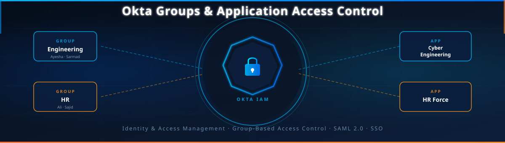
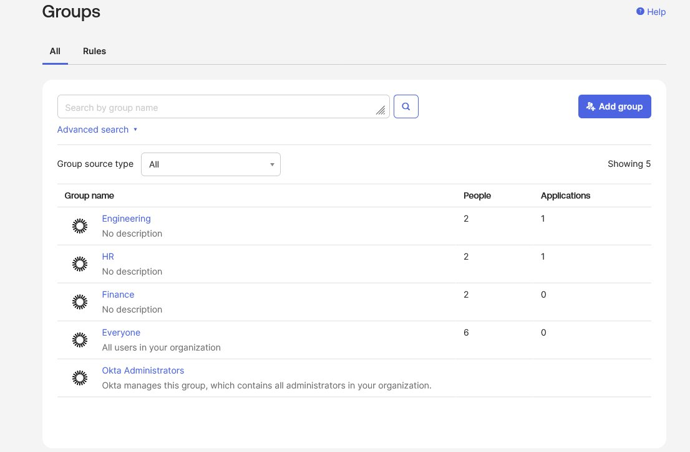
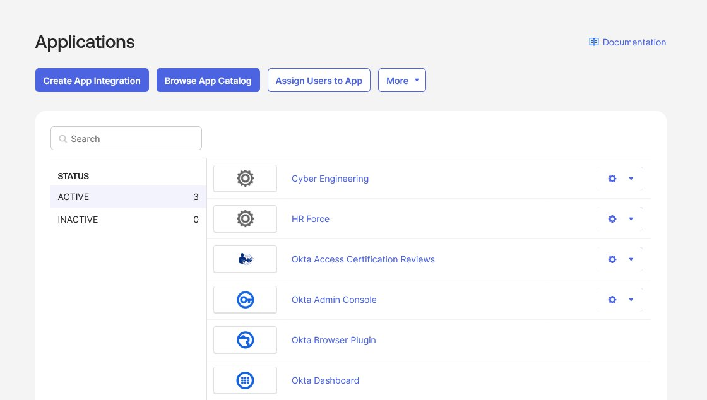
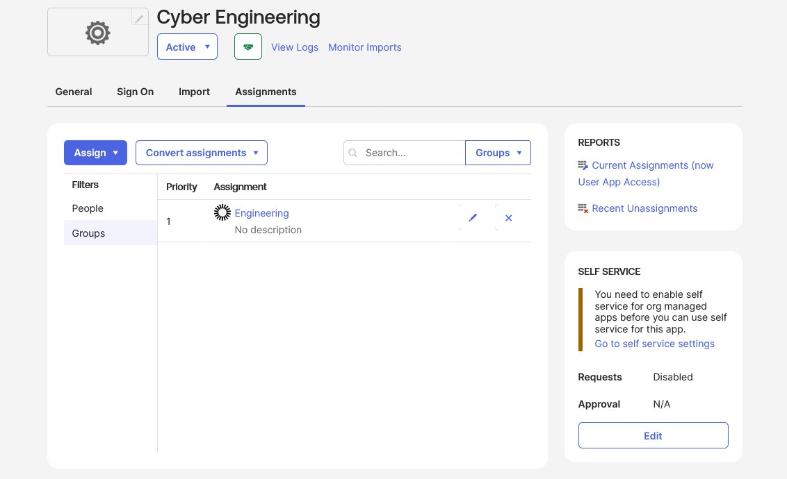
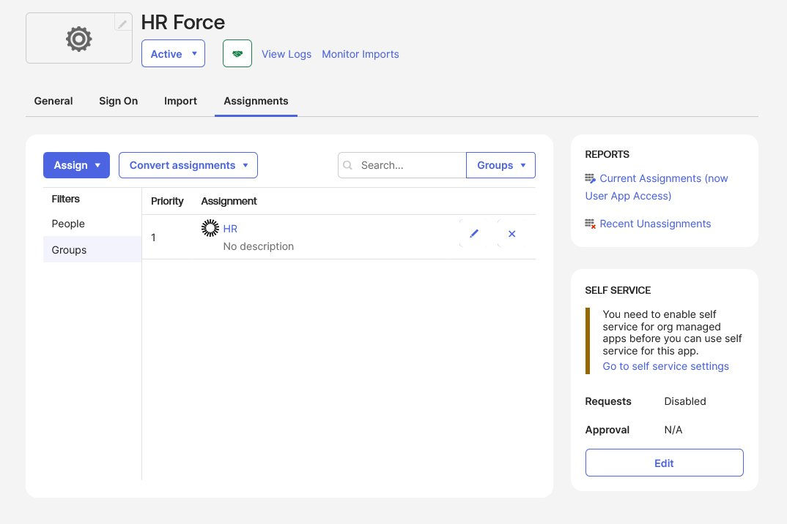
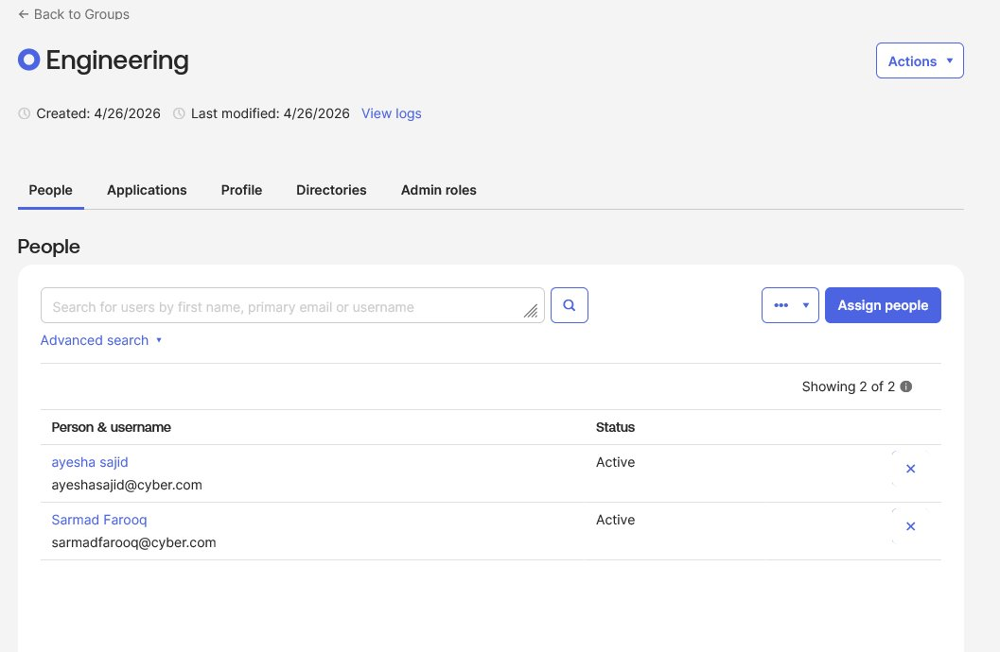
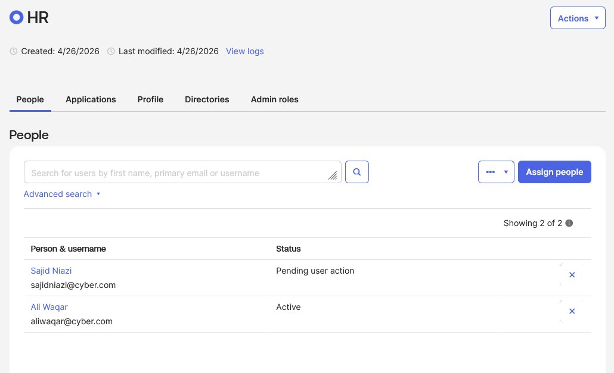
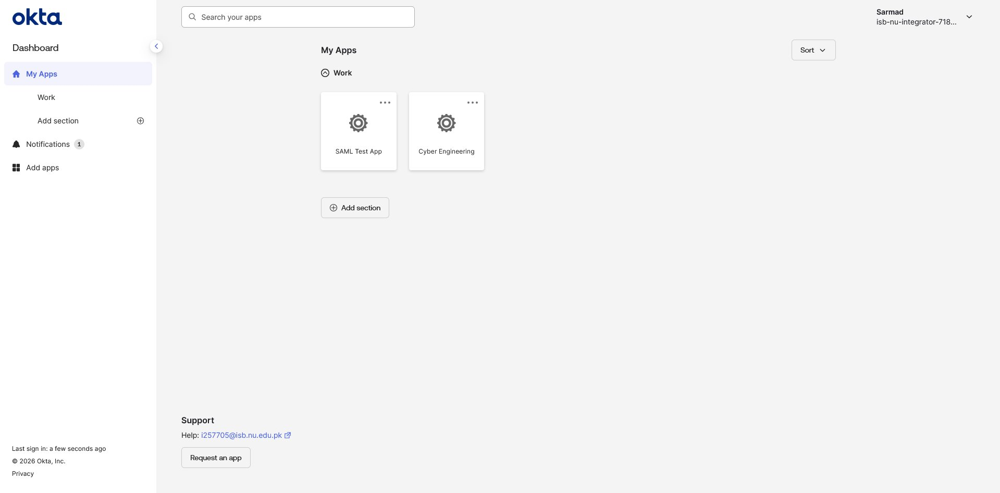
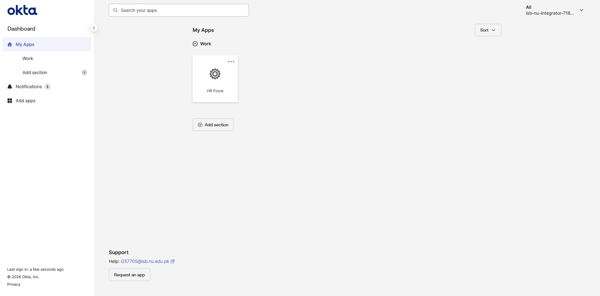
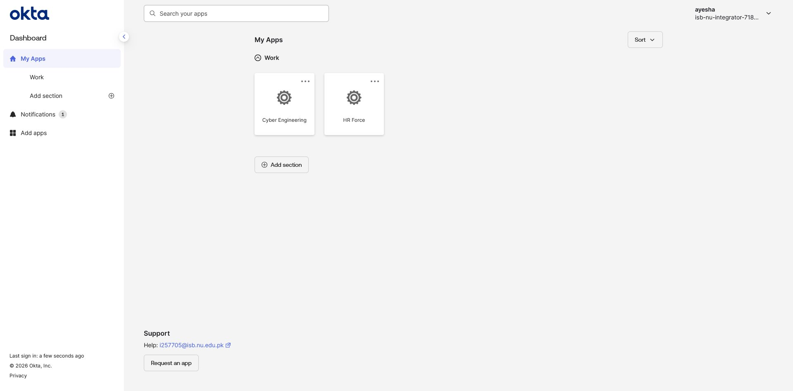

<div align="center">

<!-- BANNER -->


<br/>

# 🔐 Okta Groups & Application Access Management

### A hands-on Identity & Access Management (IAM) lab demonstrating Group-based access control using Okta's Universal Directory

<br/>

[](https://okta.com)
[](/)
[](/)
[](/)

<br/>

> **"Proving that the right people see only the right apps — zero more, zero less."**

<br/>

---

</div>

## 📋 Table of Contents

- [Overview](#-overview)
- [Architecture](#-architecture)
- [Lab Setup](#-lab-setup)
- [Step-by-Step Walkthrough](#-step-by-step-walkthrough)
  - [Step 1 — Create Groups](#step-1--create-groups)
  - [Step 2 — Create Applications](#step-2--create-applications)
  - [Step 3 — Assign Apps to Groups](#step-3--assign-apps-to-groups)
  - [Step 4 — Assign Users to Groups](#step-4--assign-users-to-groups)
  - [Step 5 — Verify User Access](#step-5--verify-user-access)
- [Key Concepts](#-key-concepts)
- [Results Summary](#-results-summary)
- [Skills Demonstrated](#-skills-demonstrated)

---

## 🌐 Overview

This project demonstrates a **real-world Okta configuration** where application access is controlled through **Group-based Assignment** — a core Identity & Access Management (IAM) pattern used in enterprise environments.

Instead of assigning applications to individual users (which doesn't scale), this lab uses **Groups** as the control plane. Users inherit app access automatically based on their group membership.

```
User → Group → Application
```

This mirrors how organizations like banks, hospitals, and tech companies enforce **least privilege access** at scale.

---

## 🏗️ Architecture

```
┌─────────────────────────────────────────────────────────┐
│                    OKTA TENANT                           │
│                                                          │
│  ┌─────────────────┐      ┌─────────────────────────┐   │
│  │   ENGINEERING   │─────▶│   Cyber Engineering App  │   │
│  │     GROUP       │      └─────────────────────────┘   │
│  │                 │                                     │
│  │  • Ayesha Sajid │                                     │
│  │  • Sarmad Farooq│                                     │
│  └─────────────────┘                                     │
│                                                          │
│  ┌─────────────────┐      ┌─────────────────────────┐   │
│  │       HR        │─────▶│      HR Force App        │   │
│  │     GROUP       │      └─────────────────────────┘   │
│  │                 │                                     │
│  │  • Sajid Niazi  │                                     │
│  │  • Ali Waqar    │                                     │
│  └─────────────────┘                                     │
│                                                          │
│  ┌────────────────────────────────────────────────────┐  │
│  │  Ayesha (Engineering) → sees BOTH apps             │  │
│  │  (assigned to both groups)                         │  │
│  └────────────────────────────────────────────────────┘  │
└─────────────────────────────────────────────────────────┘
```

---

## 🛠️ Lab Setup

| Component | Details |
|-----------|---------|
| **Platform** | Okta Developer / ISB Tenant |
| **Groups Created** | Engineering, HR |
| **Applications Created** | Cyber Engineering, HR Force |
| **Users Configured** | Ayesha Sajid, Sarmad Farooq, Ali Waqar, Sajid Niazi |
| **Access Control Method** | Group-based App Assignment |
| **Protocol** | SAML 2.0 / Okta SSO |

---

## 📸 Step-by-Step Walkthrough

### Step 1 — Create Groups

The first step is creating the logical containers that will control access. Two groups are created: **Engineering** and **HR**.

<div align="center">

<br/><em>Figure 1 — Groups panel showing Engineering, HR, Finance, and Everyone groups. Engineering and HR each have 2 members and 1 assigned application.</em>
</div>

<br/>

> **Why Groups?** Assigning apps at the group level means: when a new engineer joins, you just add them to the Engineering group — they instantly get all the right app access. No manual per-user configuration.

---

### Step 2 — Create Applications

Two custom applications are created inside Okta for testing. These simulate real enterprise SaaS tools that employees need to access via SSO.

<div align="center">

<br/><em>Figure 2 — Applications dashboard showing Cyber Engineering and HR Force apps (both Active), alongside built-in Okta apps.</em>
</div>

<br/>

> At this stage, both apps exist but **no one can see them yet** — because they haven't been linked to any groups.

---

### Step 3 — Assign Apps to Groups

This is the critical step: binding each application to its respective group.

#### 3a — Cyber Engineering → Engineering Group

<div align="center">

<br/><em>Figure 3 — The Cyber Engineering app's Assignments tab shows the Engineering group assigned with Priority 1.</em>
</div>

<br/>

#### 3b — HR Force → HR Group

<div align="center">

<br/><em>Figure 4 — The HR Force app's Assignments tab shows the HR group assigned with Priority 1.</em>
</div>

<br/>

> **Key Insight:** The app-to-group binding is set from the **Application side** in Okta Admin Console, under the `Assignments` tab. You filter by "Groups" and assign the appropriate group.

---

### Step 4 — Assign Users to Groups

Now users are placed into their respective groups, which automatically grants them access to the linked application.

#### Engineering Group Members

<div align="center">

<br/><em>Figure 5 — Engineering Group contains Ayesha Sajid and Sarmad Farooq (both Active).</em>
</div>

<br/>

#### HR Group Members

<div align="center">

<br/><em>Figure 6 — HR Group contains Ali Waqar (Active) and Sajid Niazi (Pending user action).</em>
</div>

---

### Step 5 — Verify User Access

The final step validates that users see **only** the apps their groups grant them — the ultimate test of proper access control.

#### ✅ Sarmad Farooq — Engineering Group Only

<div align="center">

<br/><em>Figure 7 — Sarmad's Okta dashboard shows Cyber Engineering (and SAML Test App from a prior lab). No HR Force visible.</em>
</div>

<br/>

#### ✅ Ali Waqar — HR Group Only

<div align="center">

<br/><em>Figure 8 — Ali's Okta dashboard shows only HR Force. No Cyber Engineering visible. ✅ Isolation confirmed.</em>
</div>

<br/>

#### ✅ Ayesha Sajid — Both Groups (Engineering + HR)

<div align="center">

<br/><em>Figure 9 — Ayesha is in both the Engineering and HR groups. Her dashboard shows BOTH Cyber Engineering and HR Force. Multi-group access works perfectly.</em>
</div>

---

## 🧠 Key Concepts

| Concept | Explanation |
|---|---|
| **Group-Based Access Control (GBAC)** | Users inherit permissions from groups, not individual assignments. Scalable and manageable. |
| **Least Privilege Principle** | Users can only see and access apps they are explicitly authorized for via group membership. |
| **Okta Universal Directory** | Centralized identity store that manages users, groups, and their relationships. |
| **App Assignment (Group level)** | Applications are assigned to groups, not individual users. Changing group membership = changing app access. |
| **Multi-Group Membership** | A user in multiple groups gets the union of all app access from each group (demonstrated by Ayesha). |
| **SAML SSO** | Secure sign-on protocol that apps use to delegate authentication to Okta. |

---

## 📊 Results Summary

| User | Group(s) | Apps Visible | Result |
|------|----------|-------------|--------|
| **Sarmad Farooq** | Engineering | Cyber Engineering | ✅ Correct |
| **Ali Waqar** | HR | HR Force | ✅ Correct |
| **Ayesha Sajid** | Engineering + HR | Cyber Engineering + HR Force | ✅ Correct |
| **Sajid Niazi** | HR | HR Force | ⏳ Pending activation |

**Isolation verified.** No user could see an app they weren't entitled to. Multi-group access correctly aggregated permissions.

---

## 🎯 Skills Demonstrated

```
✔ Okta Admin Console navigation & configuration
✔ Group creation and user assignment in Okta Universal Directory
✔ Application integration and group-based app assignment
✔ SAML 2.0 application setup
✔ Identity & Access Management (IAM) principles
✔ Least Privilege Access enforcement
✔ User access verification and audit
✔ Enterprise SSO architecture design
```

---

<div align="center">

### 🔗 Connect With Me

If you found this lab useful or want to collaborate on IAM/cybersecurity projects, feel free to connect!

<br/>

⭐ **Star this repo** if it helped you understand Okta group-based access control!

<br/>

*Built with dedication to learning Identity & Access Management*

</div>
